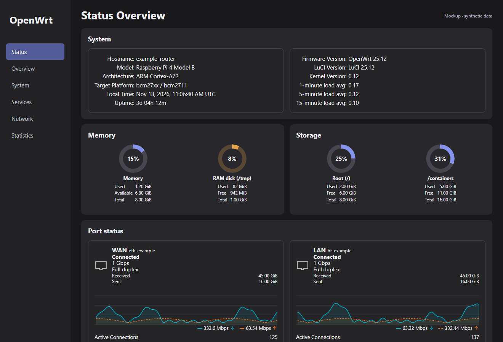
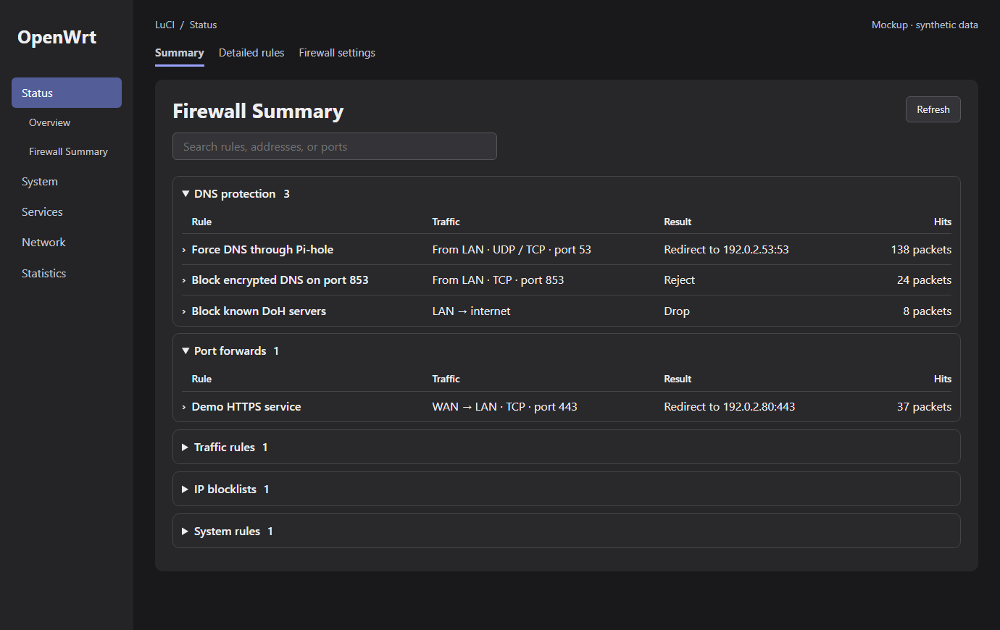
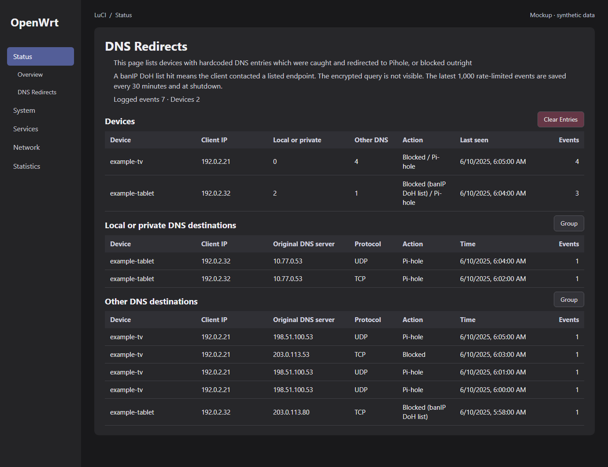

# luci-theme-argon-tweak

## Install the tweaks

1. Start with OpenWrt 25.12, LuCI and Argon 3.1.4. Install the optional LuCI apps you want to use.
2. [Download v3.1.4.1](https://api.github.com/repositories/1466932324/tarball/v3.1.4.1) and extract it on the router. From the extracted directory, run as root:

   ```sh
   sh argon-tweak/install.sh
   ```

3. Keep the rollback command the installer prints. Refresh LuCI and sign in again.

[Full installation guide](argon-tweak/README.md) · [Copy the guided setup prompt](argon-tweak/install-prompt.md)

### What the tweaks do

- **Status Overview** shows ten-minute WAN and LAN traffic charts, active clients, and gauges for memory and mounted storage. Shared bridges get one traffic chart.
- **Firewall Summary** groups active rules and lets you search by address, port or rule name and inspect packet counts.
- **DNS Redirects** groups logged port 53 attempts by device and original resolver. Enable the collector and matching firewall logging to retain history across restarts.
- **Bandwidth monitoring** adds sortable host and IP columns in nlbwmon, a 30-minute Bandix traffic view and icon buttons for device actions.
- **System and services** adds process metrics and controls, organizes the Dynamic DNS page, labels interface roles in Watchcat and explains collectd settings.
- **LuCI usability** adjusts app permissions and keeps touch dropdowns such as the banIP feed picker within view.

## Status Overview



*Mockup with fictional devices, metrics and traffic.*

## Firewall Summary

Open **Status → Firewall Summary** to see which DNS rules, port forwards and blocklists are active. Search by port, address or rule name, then expand a rule to inspect its matches and action. [Firewall Summary guide](argon-tweak/README.md#firewall-summary)



## DNS Redirects

Open **Status → DNS Redirects** to see which clients tried to use another DNS server and which server each client contacted. Group repeated attempts by client, destination and protocol. Recent history is saved every 30 minutes and at clean shutdown. [DNS Redirects guide](argon-tweak/README.md#dns-redirects)



[Upstream theme documentation](https://github.com/jerrykuku/luci-theme-argon/tree/v3.1.4)

See the upstream theme license and the [Bandix and Lucide notices](argon-tweak/licenses/). LuCI notices remain with their files.
